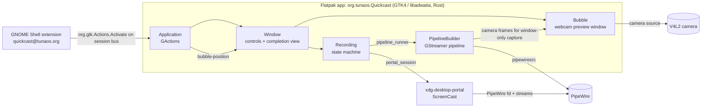

# Architecture

This document is a map of the Quickcast codebase: which components exist, how a
recording moves through them, and how the app talks to the GNOME Shell companion.
User-facing behavior lives in [README.md](../README.md); this file covers the
internals.

## Components

| Area | Location | Responsibility |
| --- | --- | --- |
| Entry and actions | `src/main.rs`, `src/application.rs` | GtkApplication `org.tunaos.Quickcast`. Exposes GActions such as `toggle-record`, `bubble-position`, `show-preferences` and `quit`. |
| Main window | `src/window/` | Recording controls, source and audio toggles, the completion view with **Copy video** and **Open video**, and the clipboard hand-off. |
| Recording state machine | `src/recording.rs` | `Recording` GObject. Owns the public lifecycle API (start, pause, resume, stop, cancel) and the `RecordingState` values. |
| Recording submodules | `src/recording/` | `portal_session.rs` (portal negotiation), `pipeline_runner.rs` (settings to pipeline), `pipeline_monitor.rs` (bus messages, duration, flush progress), `delay.rs` (cancellable countdown). |
| Portal bindings | `src/screencast_portal/` | Thin `gio::DBusProxy` wrapper for `org.freedesktop.portal.ScreenCast`, plus request/handle, variant and window-identifier helpers. |
| Pipeline builder | `src/pipeline.rs` | `PipelineBuilder` assembles the GStreamer pipeline: PipeWire source, optional crop and flip, audio sources, encoders and muxer, and the file sink. |
| Encoder profiles | `data/resources/profiles.yml` | Named container profiles (WebM/VP8, MP4/H.264 + AAC, and others) that hold the encoder and muxer pipeline fragments. Loaded from the GResource bundle by `src/profile.rs`. |
| Camera | `src/camera.rs` | V4L2 device enumeration, the camera source bin, and `attach()`, which composites camera frames into window-only recordings. |
| Webcam bubble | `src/bubble.rs` | Separate window with its own GStreamer pipeline. It feeds a preview sink and an `appsrc`-backed `CameraFeed`. The feed is shared with the recording pipeline. |
| Area selection | `src/area_selector/` | Region picker used when the capture mode is a selected area. |
| Shell companion | `extension/` | GNOME Shell extension (`quickcast@tunaos.org`). Panel toggle, and placement and stacking of the bubble window. |
| Packaging and build | `meson.build`, `Cargo.toml`, `org.tunaos.Quickcast.json`, `data/` | Meson drives the Cargo build and installs the resources, schema and desktop files. The Flatpak manifest builds the app. |

`data/` still uses the upstream Kooha identifiers in some file names, such as
`io.github.seadve.Kooha.gschema.xml.in`. The app ID in code is `org.tunaos.Quickcast`.

## Recording lifecycle

1. **Start.** The UI calls `Recording::start` (through the `toggle-record` action or
   the panel menu). `start_inner` runs in this order:
   1. `portal_session::start` opens a ScreenCast session through the desktop portal.
      The portal returns a PipeWire file descriptor and the stream list. A saved
      restore token is reused where the portal allows it.
   2. `pipeline_runner::build` creates the pipeline. In selection mode it first runs
      the area selector. Audio is added only for profiles that support it. When the
      source is a window, the camera feed from the bubble is added to the pipeline.
   3. `delay::wait` runs the optional countdown. It can be cancelled.
   4. `pipeline_monitor::start` attaches to the bus, and the pipeline moves to
      `Playing`.
2. **Capture.** Frames flow from `pipewiresrc` through the encoder queue to the
   muxer and `filesink`, in the file under `~/Videos/Quickcast` by default. Pause and
   resume change the pipeline state. The bubble keeps running independently of the
   recording.
3. **Stop.** `Recording::stop` sends an EOS event to the pipeline. The bus delivers
   EOS, and `pipeline_monitor` moves the state to `Flushing`, updating progress
   while the encoder drains.
4. **Finish.** After the bus reports successful end-of-stream, the state moves to
   `Finished` and the `finished` signal carries the `gio::File`. The window shows the
   completion view. Cancellation and errors take a different path and never reach the
   clipboard step.

## Clipboard hand-off

When a recording finishes, `Window` stores the file as the pending copy. The window
then places one `ContentProvider` on the clipboard with three formats:

- `GdkFileList`, for GTK and portal-based file transfer.
- `text/uri-list`.
- `x-special/gnome-copied-files`, for GNOME file managers.

On GNOME Wayland, the copy can need the completion window to be focused. The pending
copy is therefore retried when the window becomes active. **Copy video** triggers the
same path again. The pending copy is set only after a successful finish.

## Shell companion and IPC

The app and the Shell extension talk over the session D-Bus. There are no other
private channels between them.

- **Extension to app.** The panel menu, and any other extension code, calls
  `org.gtk.Actions.Activate` on `org.tunaos.Quickcast` at `/org/tunaos/Quickcast`.
  This is the standard GApplication action interface. Actions used are `toggle-record`
  and `bubble-position`, which takes `(x, y, width)` as relative values.
- **App to extension.** The extension does not get messages from the app. It reads
  its own GSettings schema (`org.gnome.shell.extensions.quickcast`), which stores the
  bubble's relative position and size.
- **Bubble tracking.** The extension watches for a window with the Quickcast
  application ID and the title `Quickcast Webcam`. It keeps the window above others
  and across workspaces, places it from the saved settings, and on each move or resize
  writes the new values to GSettings and sends `bubble-position` to the app. The app
  then places the bubble and uses that position for window-only recordings.
- **Portal.** The app uses `org.freedesktop.portal.ScreenCast` on the session bus for
  screen and window capture. Capture permission is granted by the portal.

Without the extension, the bubble is still shown and can be dragged. Always-on-top,
workspace pinning and the live position updates for window-only recordings do not
work.

## Build and test layout

- `meson.build` is the top-level build. It checks dependencies, compiles the
  resources, schema and translations, and runs `cargo` for the Rust crate.
- `Cargo.toml` declares the GTK, libadwaita and GStreamer crate dependencies.
  `build-aux/gsettings-macro/` is a vendored patch of `gsettings-macro`.
- `scripts/` holds the local build and test runners, the extension installer, the
  shortcut installer, and the Python helpers used by tests (`verify-video.py`,
  `read-clipboard.py`).
- `org.tunaos.Quickcast.json` is the Flatpak manifest used by CI and the local build
  script.
